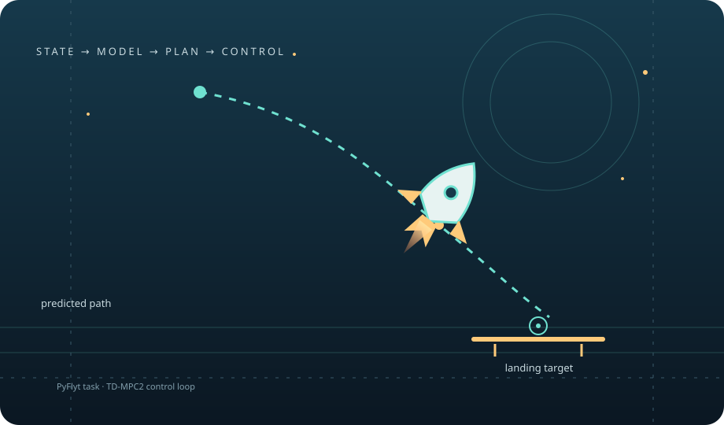

<p align="center"><a href="https://paoshou-china.github.io/harmony-TDMPC2/"><strong>Project homepage ↗</strong></a></p>



# harmony-TDMPC2: TD-MPC2 for PyFlyt Rocket Landing

This repository adapts a TD-MPC2 training codebase to the Gymnasium task
`PyFlyt/Rocket-Landing-v4`. It includes the TD-MPC2 implementation, a PyFlyt
environment adapter, rocket parameter randomization, and default Hydra
configuration for the rocket task.

The repository name and the `harmony` configuration option refer to
project-specific additions. The README does not claim that these additions
are a separately validated state-of-the-art algorithm. For scientific
comparisons, use the configurations and evaluation protocol described by the
associated project materials.

## What is implemented

- `train.py` starts online or offline TD-MPC2 training using Hydra.
- `config.yaml` selects `PyFlyt/Rocket-Landing-v4`, state observations, and
  randomized vehicle parameters by default.
- `envs/pyflyt.py` creates the PyFlyt task, wraps actions to the range
  `[-1, 1]`, converts observations to `float32`, and maps the environment's
  `env_complete` info field to the trainer's `success` metric.
- The rocket parameter template in `envs/pyflyt.py` defines nominal values
  and, for selected parameters, uniform randomization ranges.
- `config_e.yaml` is an example evaluation configuration. Its checkpoint
  path must be replaced with a path that exists on your machine.

The underlying PyFlyt task supplies the actual observation fields, reward,
success condition, and physical simulation. Check the installed task
implementation for those details; this repository's wrapper does not redefine
them.

## Method structure in this implementation

The configured training path connects the PyFlyt task adapter to the TD-MPC2 agent and replay buffer:

1. The environment wrapper converts task observations to tensors and scales actions to the environment's expected range.
2. The world model encodes observations and predicts latent transitions, reward, and (for episodic tasks) termination.
3. The planning routine evaluates sampled candidate action sequences over the configured horizon.
4. Online or offline trainers update the model from replay-buffer sequences and periodically evaluate checkpoints.

The default compute device is `cuda:0`; select another CUDA device with the Hydra override `device=cuda:1` when needed. The source config remains the authority for all experiment values.

## Requirements

The supplied `environment.yaml` specifies Python 3.9, PyTorch 2.6.0
development build with CUDA 12.4, PyFlyt 0.30.0, and the project dependencies.
Training currently requires a working CUDA-enabled PyTorch installation:
`train.py` uses CUDA-specific training paths and stops with an explanatory
error when CUDA is unavailable. The exact driver/GPU compatibility depends on
your system.

Create the environment:

```bash
conda env create -f environment.yaml
conda activate tdmpc2
```

### Rocket task dependency

The code requests the Gymnasium ID `PyFlyt/Rocket-Landing-v4`. The supplied
environment file pins `PyFlyt==0.30.0`, while the repository's earlier setup
instructions refer to a custom PyFlyt fork. Confirm that the installed PyFlyt
package registers this task and includes the expected rocket implementation.
If it does not, follow the custom fork's installation instructions and record
the exact fork commit used; do not copy files into an unspecified package
directory.

## Train

The default task is the rocket landing task. For a short run to check startup:

```bash
python train.py model_size=5 steps=10000
```

Use `steps`, `seed`, `mode`, `harmony`, and other Hydra configuration
overrides to select the experiment. For example, `mode=nominal` disables
random sampling of the parameter template in favor of its configured nominal
values. See `config.yaml` for the full set of training and planning settings.

Runs are written below `logs/<task>/<seed>/<exp_name>/`; the logger saves
models under its `models/` subdirectory when model saving is enabled. The
configuration has WandB disabled by default.

## Evaluate

Use the dedicated `evaluate.py` entry point. Override the example checkpoint
path from `config_e.yaml` with a path that exists on your machine:

```bash
python evaluate.py model_size=5 checkpoint=/path/to/model.pt eval_episodes=10
```

Evaluation requires CUDA as currently implemented. Results are printed to the
console and per-episode reward/success values are written to
`evaluate_<seed>.csv`. Video output is controlled by `save_video` in the
evaluation configuration.

## Demo videos

The following clips are illustrative examples; they are not a substitute for
the reproducible evaluation protocol or its reported metrics.

<p align="center">
  
  
  
</p>

## License

This project is distributed under the MIT License; see [LICENSE](LICENSE).
